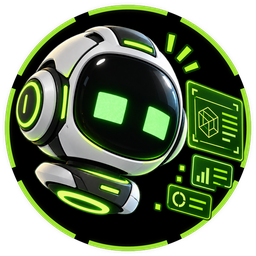
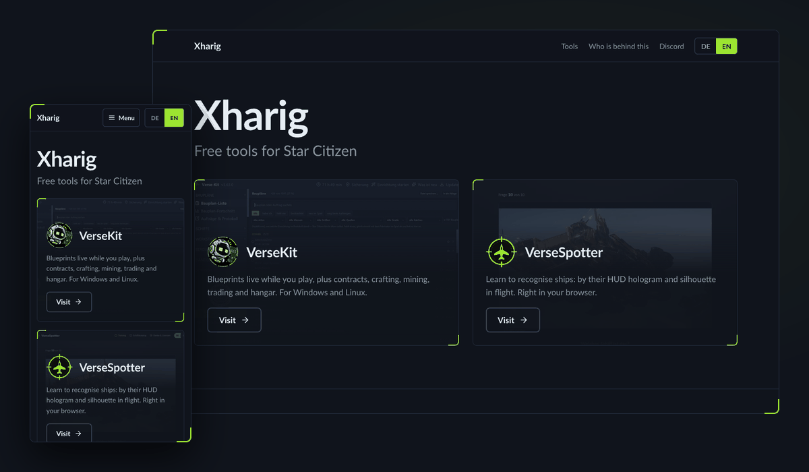

&nbsp;&nbsp;

# xharig.com

**The start page for Xharig's Star Citizen tools**

static site · German and English · no cookies

 

[Deutsch](https://github.com/Xharig/xharig.com/blob/main/README.md) · **English**

---

From here you reach both tools:

| | Tool | What it does |
|---|---|---|
|  | **[VerseKit](https://versekit.xharig.com/)** | Overlay for blueprints, contracts, crafting and trade. Windows and Linux |
|  | **[VerseSpotter](https://versespotter.xharig.com/)** | Learn to recognise ships, in your browser |

The site is static and served through GitHub Pages.

**New to Star Citizen?** Sign up with my referral code [`STAR-YC7L-S4W2`](https://robertsspaceindustries.com/enlist?referral=STAR-YC7L-S4W2) and you get 50,000 UEC of in-game credit after buying a game package.

## Star Citizen Fan Content

> This is an unofficial Star Citizen fan site, not affiliated with the Cloud Imperium group of companies. All content on this site not authored by its host or users are property of their respective owners. Star Citizen®, Roberts Space Industries® and Cloud Imperium® are registered trademarks of Cloud Imperium Rights LLC.

## License

**GNU General Public License v3.0**: full text in [LICENSE](LICENSE).

## Thanks

- **[Lucide](https://lucide.dev)**: the icons (ISC, see `assets/LICENSE-lucide.txt`).

**Xharig**: development and design of this site

Like the tool? <a href="https://ko-fi.com/xharig">Ko-fi</a> ☕

